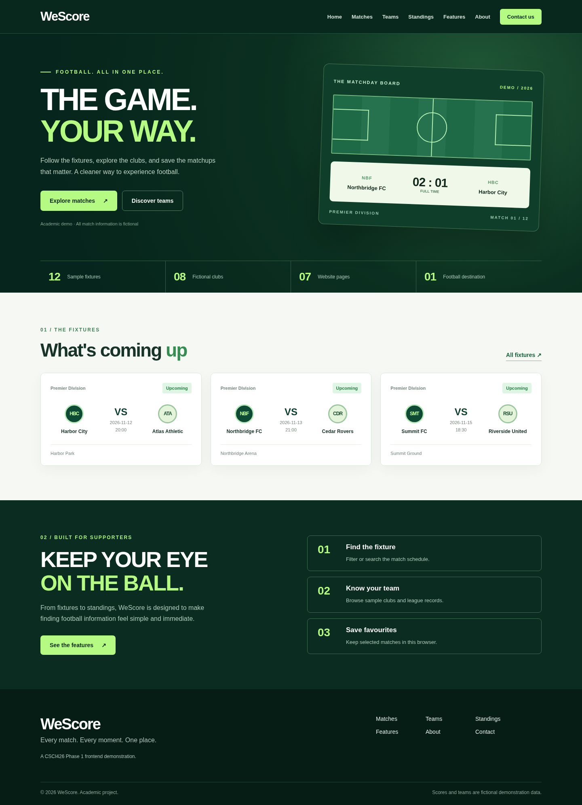
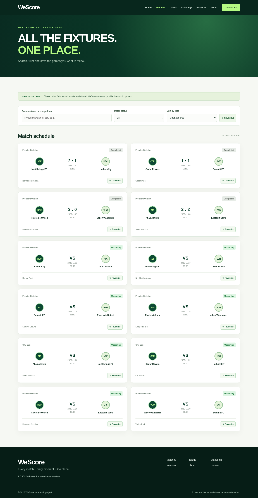
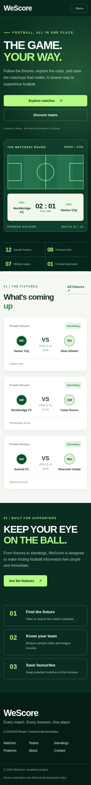

# WeScore

Football fixtures, team directory, standings and saved favourites

>  clubs, scores, dates and standings are fictional. The contact form demonstrates input validation but does not send an email or save a message to a server.

## Features and seven pages

1. **Home** (`/`) — introduction and featured fictional fixtures.
2. **Matches** (`/matches`) — search by club or competition, filter by status, sort by date, and save favourite fixtures in `localStorage`.
3. **Teams** (`/teams`) — browse clubs, search teams/cities and save favourite teams in `localStorage`.
4. **Standings** (`/standings`) — table generated from a JavaScript array using `.map()` and `.sort()`.
5. **Features** (`/features`) — overview of the functionality.
6. **About** (`/about`) — problem, objective and project information.
7. **Contact** (`/contact`) — React controlled inputs with required fields and a demo-only alert.

The desktop navigation also has a React `useState` mobile toggle. The word **WeScore** is a non-clickable text heading in the Navbar and Footer.

## UI screenshots

Screenshots of the actual locally rendered application are in `docs/screenshots/`:

